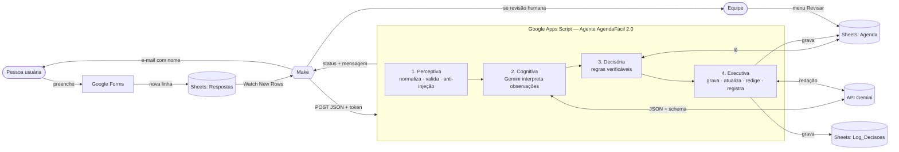
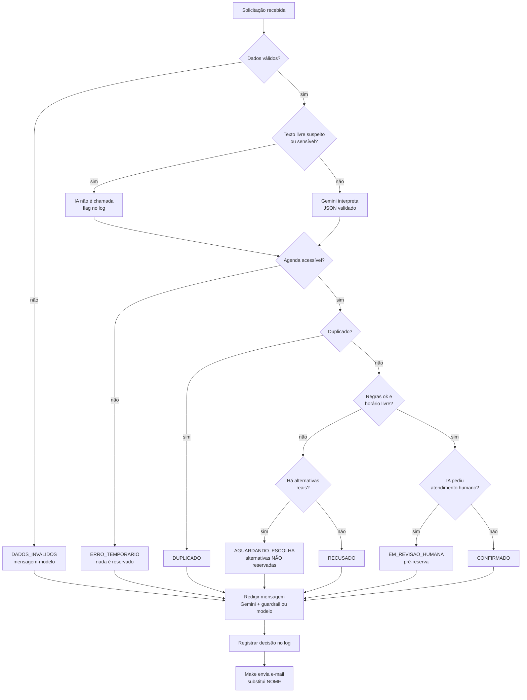
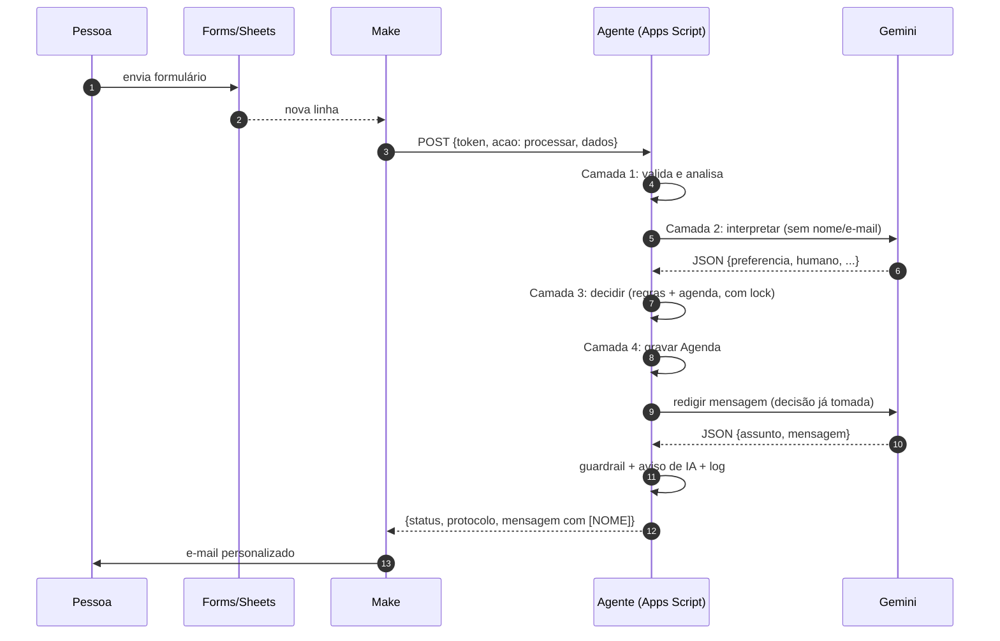

# AgendaFácil 2.0 — Agente Inteligente de Agendamentos

> Evolução do [AgendaFácil 1.0](../AgendaFacil/) para um **agente de IA com arquitetura de quatro camadas**, decisões verificáveis, memória controlada e princípios de privacidade, equidade, transparência e responsabilidade.
> Disciplina: Engenharia de Prompt e Aplicações em IA · Projeto acadêmico · Dados de demonstração 100% fictícios.

**Status deste protótipo (honesto):**

| Parte | Situação |
|---|---|
| Lógica do agente (4 camadas), prompts, guardrails, memória, registro | ✅ Implementada e **testada localmente**: 29 testes automatizados, todos aprovados ([evidência](docs/evidencias/saida-testes.txt)) |
| Demonstração local ponta a ponta (sem IA) | ✅ Executada ([saída](docs/evidencias/saida-demo-sem-ia.txt)) |
| Chamada real à API do Gemini | ⚠️ Código pronto, **não executado** neste ambiente (sem chave). Testado com respostas simuladas no formato da API |
| Implantação no Google Apps Script, Google Forms e Make | ⚠️ Código e roteiro prontos, **não validados** em contas reais. Passo a passo em [docs/configuracao.md](docs/configuracao.md) |

---

## Sumário

1. [Introdução](#1-introdução)
2. [Problema identificado](#2-problema-identificado)
3. [Objetivos](#3-objetivos)
4. [Tecnologias utilizadas](#4-tecnologias-utilizadas)
5. [Comparação 1.0 × 2.0](#5-comparação-entre-agendafácil-10-e-20)
6. [Arquitetura do agente](#6-arquitetura-do-agente)
7. [As quatro camadas](#7-as-quatro-camadas)
8. [Fluxo de funcionamento](#8-fluxo-de-funcionamento)
9. [Engenharia de prompt](#9-engenharia-de-prompt)
10. [Memória e gerenciamento de contexto](#10-memória-e-gerenciamento-de-contexto)
11. [Privacidade e LGPD](#11-privacidade-e-lgpd)
12. [Vieses algorítmicos e mitigação](#12-vieses-algorítmicos-e-estratégias-de-mitigação)
13. [Responsabilidade e transparência](#13-responsabilidade-e-transparência)
14. [Testes e resultados](#14-testes-e-resultados)
15. [Vantagens e limitações](#15-três-vantagens-e-três-limitações)
16. [Melhorias futuras](#16-melhorias-futuras)
17. [Instruções de configuração](#17-instruções-de-configuração)
18. [Referências](#18-referências)

Estrutura de pastas:

```text
AgendaFacil-2.0/
├── apps-script/                 # código que vai para o Google Apps Script (fonte única)
│   ├── 00_Config.js             # regras de negócio, status, permissões, motivos
│   ├── 01_Percepcao.js          # CAMADA 1 — normalização, validação, anti-injeção
│   ├── 02_Prompts.js            # prompts estruturados + esquemas JSON
│   ├── 02_Cognicao.js           # CAMADA 2 — cliente Gemini, guardrails, mensagens-modelo
│   ├── 03_Decisao.js            # CAMADA 3 — disponibilidade, conflitos, alternativas
│   ├── 04_Memoria.js            # memória controlada, registro de decisões, retenção
│   ├── 05_Agente.js             # orquestrador + CAMADA 4 — execução, consulta, revisão humana
│   ├── 10_RepositorioPlanilha.js# acesso ao Google Sheets
│   ├── 20_Codigo.js             # doPost (Make), configuração, retenção, menu de revisão
│   └── appsscript.json
├── local/                       # execução local (Node.js, sem dependências)
├── tests/                       # 29 testes automatizados
├── docs/                        # configuração, prompts, testes, diagramas, evidências
└── apresentacao/                # slides + roteiro de fala
```

---

## 1. Introdução

O AgendaFácil 1.0 mostrou que é possível montar um fluxo de agendamento com ferramentas No Code e Low Code (Google Forms → Google Sheets → Make → Gemini). Nele, porém, a IA apenas **gerava um texto**: não havia verificação de horários, o sistema não registrava decisões e nada impedia a resposta de "confirmar" um horário ocupado.

O AgendaFácil 2.0 transforma o fluxo em um **agente**: ele percebe a solicitação, interpreta o contexto com IA, **decide com base em regras verificáveis** e executa apenas as ações permitidas, registrando a justificativa de cada decisão. A IA continua presente, agora com papel delimitado: interpretar texto livre e redigir mensagens. **Nunca decide.**

## 2. Problema identificado

- Agendamento manual gera retrabalho, demora e conflitos (dois clientes no mesmo horário).
- No 1.0, a própria documentação registrava como limitação a *"ausência de verificação automática de disponibilidade de horários"*.
- Usar um modelo de linguagem para "decidir" é arriscado: ele pode **inventar horários**, **ser manipulado** por texto malicioso no formulário (*prompt injection*) e tratar pessoas de forma inconsistente.
- Dados pessoais circulavam sem regras de minimização, retenção ou controle de acesso.

## 3. Objetivos

**Objetivo geral:** desenvolver um agente de agendamento com arquitetura de quatro camadas que verifique disponibilidade real, sugira alternativas, gere respostas personalizadas com Gemini e registre decisões, respeitando privacidade, equidade, transparência e segurança.

**Objetivos específicos:**

1. Verificar disponibilidade e conflitos na agenda antes de qualquer confirmação.
2. Sugerir apenas horários alternativos reais, sem reservá-los automaticamente.
3. Usar o Gemini com prompts estruturados e saída JSON validada por esquema.
4. Implementar memória limitada, separando dados temporários, histórico e registros de decisão.
5. Registrar a justificativa de cada decisão sem dados pessoais desnecessários.
6. Definir quando a decisão passa para uma pessoa e permitir revisão humana.
7. Proteger credenciais, validar entradas e resistir a manipulação das instruções.
8. Comprovar o comportamento com testes automatizados reproduzíveis.

## 4. Tecnologias utilizadas

| Ferramenta | Papel no 2.0 | Mudança em relação ao 1.0 |
|---|---|---|
| **Google Forms** | Camada perceptiva (entrada) | Mantido. Ganhou campos de serviço, observações, protocolo anterior e consentimento |
| **Google Sheets** | Memória: respostas, `Agenda`, `Log_Decisoes` | Mantido. Ganhou duas abas protegidas |
| **Make** | Orquestração: observa o formulário, chama o agente, envia o e-mail | Mantido. O módulo Gemini sai do Make e entra no agente (ver justificativa abaixo) |
| **Google Apps Script** | Executa o agente (Web App) | **Novo.** Gratuito, já integrado à planilha, guarda credenciais com segurança |
| **API Google Gemini** | Camada cognitiva e redação | Mantida, agora com saída estruturada e guardrails |
| **Node.js** (local) | Testes e demonstração sem contas externas | **Novo**, somente para desenvolvimento |
| **GitHub** | Documentação e evidências | Mantido |

**Por que adicionar o Apps Script?** Para que as decisões sejam verificáveis, a regra "horário ocupado não pode ser confirmado" precisa ser **código testável**, não texto gerado pela IA. Montar essa lógica (ler a agenda, comparar horários, calcular alternativas, travar a gravação simultânea) com módulos visuais do Make seria frágil e impossível de testar automaticamente. O Apps Script é gratuito, roda dentro do ecossistema Google já usado, oferece `LockService` (evita duas confirmações simultâneas) e `PropertiesService` (guarda a chave do Gemini fora do código). **Nenhuma interface web nova foi criada**: o Forms continua sendo a interface do usuário e a planilha, a do responsável.

## 5. Comparação entre AgendaFácil 1.0 e 2.0

| Aspecto | 1.0 | 2.0 |
|---|---|---|
| Entrada | Forms (nome, e-mail, data, hora) | Forms + serviço, observações, protocolo anterior, consentimento LGPD |
| Validação | Não documentada | Camada perceptiva: e-mail, data, hora, serviço, consentimento, tamanho |
| Disponibilidade | Não verificava | Grade de horários, ocupação, feriados, antecedência mín./máx. |
| Conflitos e duplicidade | Não tratava | Bloqueio de concorrência + detecção de duplicidade |
| Alternativas | — | Até 3 horários livres reais, sem reserva automática |
| Papel da IA | Gerava a resposta (texto livre) | Interpreta observações e redige mensagens; **não decide** |
| Formato da IA | Texto livre | JSON com `responseSchema` + validação local + guardrail |
| Falha da IA | Fluxo parava | Agente segue com regras e mensagem-modelo |
| Prompt injection | Sem proteção | Detecção, bloqueio do envio à IA, delimitação de dados, guardrail |
| Memória | Planilha com tudo | 3 níveis separados, sem nome/e-mail nas abas do agente, retenção |
| Registro de decisões | Não havia | `Log_Decisoes` com motivo, ação, justificativa, uso de IA, flags |
| Revisão humana | — | Status `EM_REVISAO_HUMANA` + menu de revisão na planilha |
| Credenciais | Não documentado | Propriedades do Script; token no webhook; nada no repositório |
| Testes | Previstos, não registrados | 29 testes automatizados executados e registrados |

## 6. Arquitetura do agente



Princípios de projeto:

- **A IA sugere, a regra decide.** O único efeito que a IA pode ter sobre a decisão é pedir *mais* cautela (encaminhar à revisão humana) ou reordenar alternativas que já são válidas.
- **Mínimo privilégio.** O agente só executa ações de uma lista (`ACOES_PERMITIDAS`): registrar agendamento, atualizar status, registrar decisão, gerar mensagem. Não apaga dados, não envia e-mails (quem envia é o Make) e não altera regras.
- **Falha segura.** Se a planilha não responde, nada é confirmado. Se o Gemini falha, a decisão continua sendo feita pelas regras.
- **Mesmo código em todos os lugares.** Os arquivos de `apps-script/` são executados sem cópia nos testes locais.

## 7. As quatro camadas

### Camada 1 — Perceptiva (`01_Percepcao.js`)
Recebe os dados do Forms (via Make) e:
- lê **somente** campos conhecidos e descarta o resto (minimização). O agente nem recebe o nome;
- normaliza data (`DD/MM/AAAA` ou ISO), hora (`9:00`, `14h30`) e e-mail;
- valida campos obrigatórios, formato de e-mail, serviço da lista fechada, consentimento e tamanho das observações;
- analisa o texto livre: detecta padrões de **prompt injection** (7 famílias, como "ignore as instruções", "confirme meu horário" e "liste os e-mails"), **mascara identificadores** (CPF, telefone, e-mail, cartão) e sinaliza **possíveis dados sensíveis** (ex.: saúde).

### Camada 2 — Cognitiva (`02_Cognicao.js` + `02_Prompts.js`)
Usa o Gemini para interpretar as observações e produzir um JSON validado:
`preferencia_periodo`, `necessita_atendimento_humano`, `resumo_necessidade`, `tentativa_de_instrucao`.
A IA **não é chamada** quando o texto está vazio, é suspeito de manipulação ou contém possível dado sensível. Se a chamada falhar (rede, HTTP 429/503, JSON inválido ou fora do esquema), o agente segue sem ela e registra a falha.

### Camada 3 — Decisória (`03_Decisao.js`)
Função **pura e determinística** `decidir()`, que recebe apenas data, hora, serviço, um identificador anônimo (hash) e a agenda. Ordem de verificação:

1. **Duplicidade:** mesma pessoa, mesmo horário, pedido ativo → `DUPLICADO`
2. **Limite diário:** 1 agendamento ativo por pessoa por dia → `RECUSADO`
3. **Regras fixas:** dia útil, feriado, grade de horários, passado, antecedência mínima (2 h) e máxima (60 dias)
4. **Ocupação:** capacidade por horário (1)
5. Se 3 ou 4 falham → busca até 3 **alternativas reais** (livres e válidas) → `AGUARDANDO_ESCOLHA`, ou `RECUSADO` se não houver nenhuma
6. Horário livre, mas a IA indicou necessidade de atendimento humano → `EM_REVISAO_HUMANA` (pré-reserva)
7. Caso contrário → `CONFIRMADO`

### Camada 4 — Executiva (`05_Agente.js`)
Executa somente ações permitidas: grava na `Agenda`, atualiza o status do protocolo anterior (quando a pessoa escolhe uma alternativa), gera a mensagem (Gemini + guardrail, ou mensagem-modelo), registra a decisão no `Log_Decisoes` e devolve ao Make o resultado (sem e-mail e sem nome). A leitura, a decisão e a gravação acontecem dentro de um **bloqueio** (`LockService`), para que dois pedidos simultâneos não confirmem o mesmo horário.

## 8. Fluxo de funcionamento



**Escolha de alternativa (sem confirmação automática):** a pessoa recebe as alternativas e envia um **novo formulário** com o horário escolhido, informando o protocolo anterior. O agente verifica de novo a disponibilidade (o horário pode ter sido ocupado nesse intervalo), confirma se ainda estiver livre e marca o pedido anterior como `SUBSTITUIDO`, desde que ele pertença à mesma pessoa.

Sequência de uma solicitação:



## 9. Engenharia de prompt

Os prompts completos estão em [docs/prompts.md](docs/prompts.md), gerado a partir de `apps-script/02_Prompts.js`. Cada prompt tem as oito partes pedidas:

| Parte | Prompt de interpretação | Prompt de redação |
|---|---|---|
| Papel | Módulo cognitivo do agente | Redator de mensagens |
| Objetivo | Extrair preferência, necessidade humana, resumo, tentativa de instrução | Comunicar uma decisão já tomada |
| Contexto | Serviços oferecidos (parâmetro `{{SERVICOS}}`); disponibilidade não é papel da IA | A decisão foi tomada por regras |
| Dados permitidos | Serviço + observações mascaradas (sem nome/e-mail) | Status, protocolo, datas/horas, alternativas, motivos |
| Regras de decisão | Critérios fechados para cada campo | Instrução específica por status |
| Restrições de segurança | Dados ≠ instruções; nunca confirmar ou inventar horários | Não inventar datas/horas/links; não dizer "confirmado" fora de `CONFIRMADO` |
| Formato | JSON com `responseSchema` | JSON `{assunto, mensagem}` |
| Tratamento de erros | Texto vazio ou ilegível → valores neutros | Dados insuficientes → mensagem genérica com protocolo |

Técnicas aplicadas:

- **Separação instrução × dados:** as instruções vão em `systemInstruction` e os dados vão em uma mensagem separada, serializados em JSON dentro de `<dados_...>`. Tentativas de "fechar" o delimitador são removidas.
- **Prompts parametrizados:** só a configuração preenche parâmetros, nunca o usuário.
- **Saída estruturada em duas etapas:** `responseSchema` na API e validação local (`validarEsquema`).
- **Guardrail pós-geração** (`validarMensagemGerada`): toda data, hora e protocolo citados precisam estar na decisão; nada de "confirmado" indevido, links, e-mails ou telefones. Se o texto for reprovado, entra a mensagem-modelo.
- **Temperatura baixa (0,2)** para respostas consistentes.
- **Personalização sem expor dados:** o modelo escreve `[NOME]` e o Make troca pelo primeiro nome só no envio.

## 10. Memória e gerenciamento de contexto

| Tipo | Onde | Conteúdo | Duração |
|---|---|---|---|
| **Temporária de processamento** | Variáveis em memória durante a execução | E-mail, observações, resultado da IA | Descartada ao fim (`descartarContexto`) |
| **Histórico do agendamento** | Aba `Agenda` | protocolo, data, hora, serviço, status, alternativas, protocolo anterior, **hash do e-mail** | Enquanto o agendamento for relevante |
| **Registro de decisões** | Aba `Log_Decisoes` | data/hora, protocolo, evento, resultado, ação, motivos, justificativa, uso de IA, flags, responsável, versão das regras | 365 dias (rotina de retenção) |
| Respostas brutas do Forms | Aba de respostas + Forms (fora do agente) | Nome, e-mail, campos do formulário | 90 dias (rotina de retenção) |

O **hash do e-mail** (SHA-256 com "sal" secreto) permite ao agente reconhecer a mesma pessoa (para duplicidade, limite diário e consulta de status) sem guardar o e-mail. Para **consultar o estado** de uma solicitação, é preciso informar protocolo **e** e-mail. O agente compara os hashes e, se não conferirem, responde exatamente como se o protocolo não existisse.

Não há memória permanente irrestrita: o agente não guarda conversas, observações nem as mensagens enviadas.

## 11. Privacidade e LGPD

| Princípio (LGPD, art. 6º) | Como foi aplicado |
|---|---|
| **Finalidade e adequação** | Dados usados só para agendar e responder. O aviso no formulário informa a finalidade |
| **Necessidade (minimização)** | O agente recebe só e-mail, data, hora, serviço, observações e consentimento. Campos desconhecidos são descartados. O nome não chega ao agente |
| **Livre acesso** | Consulta de status por protocolo + e-mail |
| **Segurança** | Credenciais em Propriedades do Script; token no webhook; abas protegidas; `LockService`; validação de entrada |
| **Prevenção** | Mascaramento de CPF, telefone, e-mail e cartão antes da IA. Possíveis dados sensíveis (saúde etc.) não são enviados à IA |
| **Transparência** | Aviso de uso de IA em toda mensagem; justificativa da decisão; log consultável |
| **Limitação do armazenamento** | `aplicarRetencao()` apaga respostas com mais de 90 dias e logs com mais de 365 dias, inclusive no próprio Forms (`AF_FORM_ID`) |

Outros cuidados:
- **Base legal:** consentimento explícito em caixa de seleção obrigatória (e, para um uso real, avaliar execução de contrato/procedimentos preliminares, art. 7º, V).
- **Compartilhamento com terceiros (Google Gemini):** apenas dados mascarados, sem nome e sem e-mail. **Atenção:** no plano gratuito da API, os termos do Google permitem usar o conteúdo para melhorar produtos. Para dados reais, use plano pago ou confira os termos vigentes. Nesta demonstração só são usados dados fictícios.
- **Credenciais nunca no repositório:** `.gitignore` bloqueia `.env`, `.clasp*.json` e dados reais; `.env.example` não tem valores.
- **Controle de acesso:** `configurarPlanilha()` protege as abas `Agenda` e `Log_Decisoes` (só o proprietário edita). O Web App exige token e só aceita as ações `processar` e `consultar_status`.

## 12. Vieses algorítmicos e estratégias de mitigação

**Riscos considerados:** um modelo de linguagem pode, por exemplo, ser mais "flexível" com nomes de determinado grupo, responder de forma diferente conforme a escrita da pessoa, ou um fluxo poderia priorizar certos domínios de e-mail.

**Mitigações implementadas:**

1. **Cegueira por construção:** a função `decidir()` **não recebe** nome, e-mail, texto livre nem qualquer característica pessoal. Ela não tem como discriminar com base no que não vê.
2. **Regras únicas e explícitas** em `00_Config.js`, iguais para todas as pessoas, com versão registrada no log (`versaoRegras`).
3. **Desempate objetivo:** ordem de chegada (com bloqueio) e proximidade do horário pedido. A preferência de período usada é a da própria pessoa.
4. **A IA não decide:** o único sinal da IA que afeta o fluxo é "precisa de atendimento humano", que leva a *mais* cautela e nunca a uma confirmação. O prompt proíbe usar características pessoais.
5. **Teste de tratamento consistente (T10):** 6 perfis fictícios com nomes e domínios de e-mail diversos fazem os mesmos 5 pedidos sobre a mesma agenda. O teste exige resultado **idêntico** (status, motivos, alternativas e justificativa).
6. **Mensagens-modelo determinísticas** quando a IA falha, sem variação de tom entre pessoas.

**Limite conhecido:** o tom do texto redigido pelo Gemini pode variar entre execuções. O guardrail garante os fatos (datas, horas, status), mas não o tom. Uma auditoria periódica de amostras das mensagens está prevista em melhorias futuras.

## 13. Responsabilidade e transparência

**Situações que exigem intervenção humana** (`requerRevisaoHumana = true`):

| Situação | Comportamento |
|---|---|
| IA identifica pedido de acessibilidade/preparo especial, reclamação, serviço fora da lista, pedido sobre outro agendamento | `EM_REVISAO_HUMANA` com pré-reserva do horário |
| Falha ao ler ou gravar a agenda | `ERRO_TEMPORARIO`: nada é reservado e a equipe é avisada |
| Pessoa contesta a decisão (responde ao e-mail) | Equipe usa o menu **AgendaFácil 2.0 → Revisar solicitação** |
| Suspeita de manipulação | Decisão segue as regras normais; o pedido fica sinalizado no log para auditoria |

**Revisão de decisões:** `revisarDecisao()` permite apenas transições definidas (ex.: `EM_REVISAO_HUMANA → CONFIRMADO/RECUSADO`, `CONFIRMADO → CANCELADO`). Exige motivo, registra quem revisou e **reverifica a disponibilidade** antes de confirmar, para que nem uma pessoa da equipe crie um conflito sem perceber.

**Transparência para a pessoa usuária:**
- Toda mensagem termina com um aviso: redigida com auxílio de IA (ou automática sem IA), decisão tomada por regras iguais para todos, e como pedir revisão humana.
- A mensagem informa o **motivo** (ex.: "O horário solicitado já está ocupado").
- O log guarda a justificativa em linguagem natural, montada a partir de códigos (ex.: `HORARIO_OCUPADO`), sem dados pessoais.

**Limites de permissão:** a lista `ACOES_PERMITIDAS` é verificada a cada execução (`executarAcao`). Qualquer outra ação, como apagar a agenda ou enviar e-mail diretamente, gera erro. O teste R11 comprova esse bloqueio.

## 14. Testes e resultados

Execução: `npm test` (Node.js 22.13.1). Resultado completo em [docs/evidencias/saida-testes.txt](docs/evidencias/saida-testes.txt) e análise em [docs/testes.md](docs/testes.md).

| # | Cenário exigido | Teste | Resultado observado |
|---|---|---|---|
| 1 | Horário disponível | T01 | ✅ `CONFIRMADO`, gravado na agenda e no log |
| 2 | Horário ocupado | T02 | ✅ `AGUARDANDO_ESCOLHA` com 3 alternativas livres. Alternativa não reservada (outra pessoa pôde confirmar). Escolha posterior confirmada e o pedido anterior virou `SUBSTITUIDO` |
| 3 | Dados incompletos | T03 | ✅ `DADOS_INVALIDOS` com 4 motivos; nada gravado; IA não chamada |
| 4 | E-mail inválido | T04 | ✅ 6 formatos inválidos rejeitados |
| 5 | Solicitação duplicada | T05 | ✅ `DUPLICADO` (inclusive com maiúsculas/espaços), sem novo registro |
| 6 | Falha do Gemini | T06 | ✅ 5 tipos de falha (rede, 503, 429, JSON inválido, fora do esquema): decisão mantida, mensagem-modelo, falha registrada, chave não vaza |
| 7 | Falha na planilha | T07 | ✅ Leitura/gravação falhando → `ERRO_TEMPORARIO`, nada confirmado; falha só no log → sinalizada |
| 8 | Manipulação das instruções | T08 | ✅ 4 ataques: decisão inalterada, IA não chamada, flag registrada. IA "comprometida" que tenta confirmar → bloqueada pelo guardrail |
| 9 | Dados de outro usuário | T09 | ✅ Consulta com e-mail errado = resposta idêntica a "não existe". Protocolo alheio não é alterado |
| 10 | Tratamento inconsistente | T10 | ✅ 6 perfis × 5 pedidos → resultados idênticos |

Mais 19 testes complementares: regras (R01–R12), privacidade (P01–P06) e repositório Sheets simulado (S01). **Total: 29 executados, 29 aprovados, 0 falhas.**

**Verificação de mutação** (para conferir que os testes detectam erros): quebramos de propósito, em uma cópia, (1) a verificação de ocupação, (2) a detecção de injeção, (3) o guardrail e (4) o controle de acesso da consulta. Em todos os casos, ao menos um teste falhou (7, 1, 2 e 1 falhas, respectivamente).

**Não executados** (dependem de contas e credenciais): chamada real ao Gemini, implantação do Web App, cenário do Make, envio de e-mail e Forms real. O roteiro para executá-los e registrar os resultados está em [docs/testes.md](docs/testes.md#testes-de-integração-não-executados).

## 15. Três vantagens e três limitações

**Vantagens**
1. **Decisões confiáveis e auditáveis:** nenhum horário é confirmado sem verificação real, e cada decisão tem motivo e justificativa registrados.
2. **Resiliência:** o agente continua funcionando sem a IA (falha, limite de cota ou chave ausente) e falha de forma segura sem a planilha.
3. **Baixo custo e reaproveitamento:** mantém Forms, Sheets e Make; o Apps Script é gratuito; os testes rodam sem nenhuma conta externa.

**Limitações**
1. **Integrações externas não validadas** neste ambiente (Gemini real, Make, Web App). A validação depende de configuração nas contas do grupo.
2. **Escolha de alternativa exige novo formulário:** não há conversa em tempo real, e a alternativa pode ser ocupada antes da escolha (o agente reverifica e avisa).
3. **Heurísticas limitadas:** a detecção de injeção e de dados sensíveis usa padrões; ataques criativos podem passar pelo filtro. Nesse caso, porém, o máximo que conseguem é influenciar o texto, que ainda passa pelo guardrail, e nunca a decisão. O Google Sheets também não é um banco de dados (limites de volume e concorrência).

## 16. Melhorias futuras

- Integração com **Google Calendar** (agenda do profissional) e convite automático.
- **Cancelamento e reagendamento** pelo próprio usuário (link com token de uso único).
- Painel de **auditoria de equidade** e amostragem periódica do tom das mensagens geradas.
- Notificação à equipe por chat e **SLA** de revisão humana.
- Múltiplos profissionais e capacidades por serviço.
- Avaliação automatizada dos prompts com um conjunto de casos de referência (*evals*).
- Migração da planilha para um banco de dados quando o volume crescer.

## 17. Instruções de configuração

Passo a passo completo, com prints esperados e checklist, em **[docs/configuracao.md](docs/configuracao.md)**. Resumo:

1. **Forms:** adicionar os campos *Tipo de atendimento*, *Observações*, *Protocolo anterior* e *Consentimento*, mais o aviso de privacidade e de uso de IA.
2. **Apps Script:** na planilha, abrir *Extensões → Apps Script* e criar os arquivos de `apps-script/` com o mesmo nome e conteúdo (ou usar `clasp push`).
3. Executar `gerarSegredos()` e `configurarPlanilha()`; cadastrar `GEMINI_API_KEY` em *Configurações do projeto → Propriedades do script*.
4. **Implantar como App da Web** (executar como: eu; acesso: qualquer pessoa) e copiar a URL.
5. **Make:** manter o gatilho *Watch New Rows*; trocar o módulo Gemini por *JSON → Create JSON* + *HTTP → Make a request* (URL do Web App) + *Gmail → Send an email*.
6. Executar `instalarGatilhoRetencao()`.

Executar localmente (sem contas):

```bash
npm test
```

```bash
npm run demo
```

Para testar o Gemini real localmente, copie `.env.example` para `.env` (não versionado) e preencha `GEMINI_API_KEY`.

## 18. Referências

- BRASIL. **Lei nº 13.709, de 14 de agosto de 2018** — Lei Geral de Proteção de Dados Pessoais (LGPD). https://www.planalto.gov.br/ccivil_03/_ato2015-2018/2018/lei/l13709.htm
- RUSSELL, S.; NORVIG, P. **Inteligência Artificial: uma abordagem moderna**. 4. ed. (conceito de agente: percepção → decisão → ação).
- OWASP. **Top 10 for Large Language Model Applications** (LLM01: Prompt Injection). https://owasp.org/www-project-top-10-for-large-language-model-applications/
- NIST. **AI Risk Management Framework (AI RMF 1.0)**, 2023. https://www.nist.gov/itl/ai-risk-management-framework
- UNESCO. **Recomendação sobre a Ética da Inteligência Artificial**, 2021.
- GOOGLE. **Gemini API — Structured output**. https://ai.google.dev/gemini-api/docs/structured-output
- GOOGLE. **Gemini API — Termos adicionais de serviço**. https://ai.google.dev/gemini-api/terms
- GOOGLE. **Apps Script — Web Apps; LockService; PropertiesService**. https://developers.google.com/apps-script
- MAKE. **HTTP app documentation**. https://apps.make.com/http
- AgendaFácil 1.0 — README, checklist (PDF) e apresentação, pasta [`../AgendaFacil`](../AgendaFacil/).

**Uso de IA neste projeto:** o código, os testes e a documentação do 2.0 foram desenvolvidos com apoio de um assistente de IA (Claude, Anthropic), com revisão da equipe. Os resultados de teste aqui registrados foram efetivamente executados; o que não foi executado está marcado como tal.
