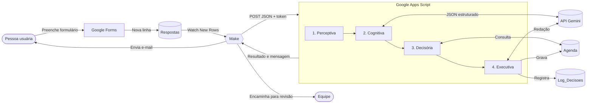
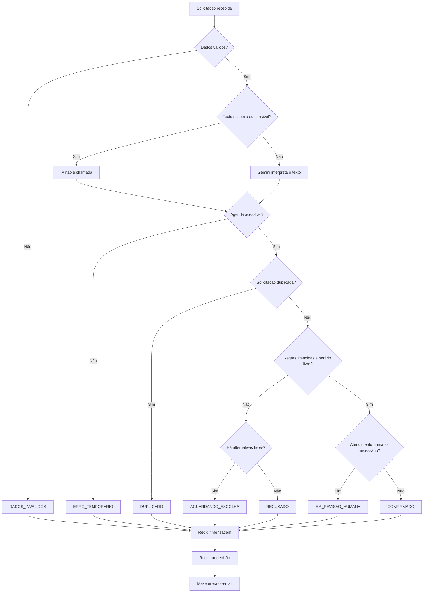
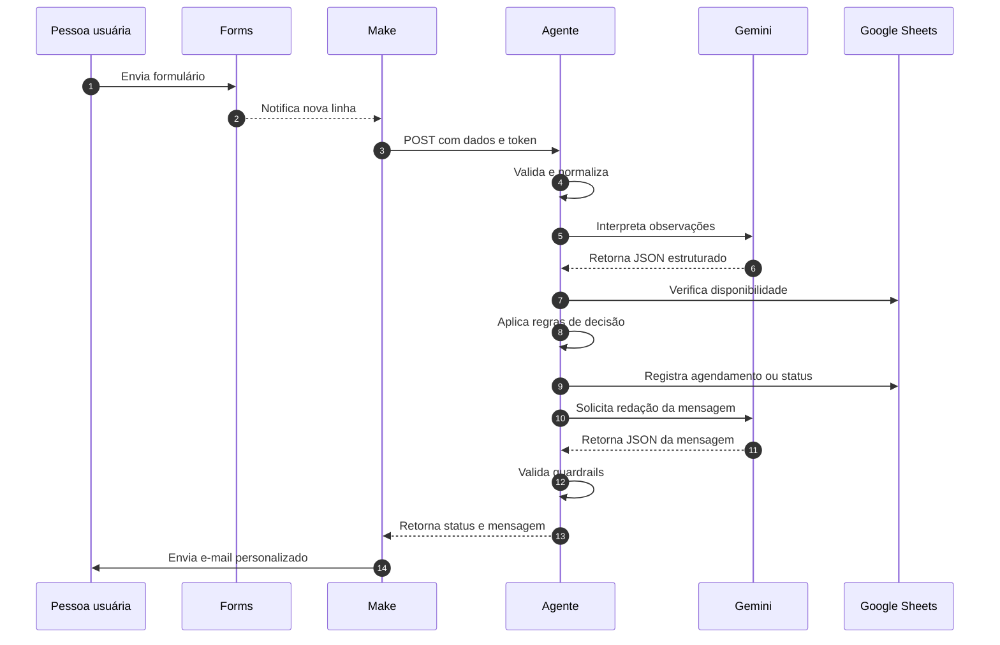

Vou corrigir a estrutura Markdown, remover quebras/truncamentos visuais e padronizar títulos, tabelas e blocos de código. Posso devolver o README completo pronto para substituir o arquivo.```markdown
# AgendaFácil 2.0 — Agente Inteligente de Agendamentos

**Unidade 4 — Aplicações e Limitações: Agentes e Ética**  
**Projeto Final — Entrega final da A1**

Projeto Final da disciplina **Tendências de Ciência da Computação**, atividades da Unidade 4 — novembro de 2026.

**Professora:** Kadidja Valéria

**Valor:** até 5 pontos

**Disciplina:** Engenharia de Prompt e Aplicações em IA  
**Projeto acadêmico:** dados de demonstração 100% fictícios.

## Integrantes

| Nome | RGM |
|---|---:|
| Maria Cecília Araújo Lemos | 33478406 |
| Gabriella Oliveira de Souza Dias | 34260641 |

---

## Atividades da unidade

| Data | Tema | Atividade | Onde está no projeto |
|---|---|---|---|
| 5 de nov. | IV – Agentes e Ética | Criação de agentes de IA | Arquitetura de quatro camadas em `apps-script/` e neste README |
| 12 de nov. | IV – Agentes e Ética | Chatbot e ferramentas de chatbot | Integração com Gemini e prompts em `02_Prompts.js` |
| 19 de nov. | IV – Agentes e Ética | Viés algorítmico e responsabilidade social | Análise ética em `docs/` e neste README |
| 26 de nov. | IV – Projeto Final | Apresentação da solução inteligente | Slides e roteiro em `apresentacao/` |
| 26 de nov. | IV – Projeto Final | Integração dos conceitos em solução aplicada | Este repositório e `docs/testes.md` |

---

## Evolução do projeto

O projeto AgendaFácil 2.0 é uma evolução do [AgendaFácil 1.0](../AgendaFacil/).

O 1.0 apresentou um fluxo de agendamento com Google Forms, Google Sheets, Make e Gemini. Nesse projeto, porém, a IA apenas gerava respostas e não verificava a disponibilidade dos horários.

O AgendaFácil 2.0 transforma o fluxo em um agente inteligente que:

- percebe e valida a solicitação;
- interpreta o contexto com IA;
- decide com base em regras verificáveis;
- executa somente ações autorizadas;
- sugere alternativas reais;
- controla memória temporária e histórica;
- registra justificativas;
- permite revisão humana;
- aplica princípios de privacidade, equidade e transparência.

> **Status do protótipo:** a lógica do agente foi implementada e testada localmente. As integrações externas ainda não foram validadas em contas reais.

| Parte | Situação |
|---|---|
| Arquitetura de quatro camadas, prompts, guardrails e memória | Implementada e testada localmente |
| Testes automatizados | 29 testes aprovados |
| Demonstração local ponta a ponta sem IA | Executada |
| API real do Gemini | Código pronto, não executado neste ambiente |
| Google Apps Script, Google Forms e Make | Código e roteiro prontos, não validados em contas reais |

---

## Sumário

1. [Introdução](#1-introdução)
2. [Problema identificado](#2-problema-identificado)
3. [Objetivos](#3-objetivos)
4. [Tecnologias utilizadas](#4-tecnologias-utilizadas)
5. [AgendaFácil 1.0 × 2.0](#5-agendafácil-10--20)
6. [Arquitetura do agente](#6-arquitetura-do-agente)
7. [As quatro camadas](#7-as-quatro-camadas)
8. [Fluxo de funcionamento](#8-fluxo-de-funcionamento)
9. [Engenharia de prompt](#9-engenharia-de-prompt)
10. [Memória e gerenciamento de contexto](#10-memória-e-gerenciamento-de-contexto)
11. [Privacidade e LGPD](#11-privacidade-e-lgpd)
12. [Vieses algorítmicos e mitigação](#12-vieses-algorítmicos-e-mitigação)
13. [Responsabilidade e transparência](#13-responsabilidade-e-transparência)
14. [Testes e resultados](#14-testes-e-resultados)
15. [Vantagens e limitações](#15-vantagens-e-limitações)
16. [Melhorias futuras](#16-melhorias-futuras)
17. [Configuração](#17-configuração)
18. [Referências](#18-referências)

---

## Estrutura de pastas

```text
AgendaFacil-2.0/
├── apps-script/
│   ├── 00_Config.js              # Regras e configurações
│   ├── 01_Percepcao.js           # Camada perceptiva
│   ├── 02_Prompts.js             # Prompts e esquemas JSON
│   ├── 02_Cognicao.js            # Camada cognitiva
│   ├── 03_Decisao.js             # Camada decisória
│   ├── 04_Memoria.js             # Memória e retenção
│   ├── 05_Agente.js              # Orquestração e execução
│   ├── 10_RepositorioPlanilha.js # Repositório do Google Sheets
│   ├── 20_Codigo.js              # Web App e gatilhos
│   └── appsscript.json
├── local/
│   └── Código de execução local
├── tests/
│   └── 29 testes automatizados
├── docs/
│   ├── configuracao.md
│   ├── prompts.md
│   ├── testes.md
│   ├── diagramas/
│   └── evidencias/
└── apresentacao/
    ├── slides
    └── roteiro de apresentação
```

---

## 1. Introdução

O AgendaFácil 1.0 mostrou que um fluxo de agendamento pode ser montado com ferramentas No Code e Low Code, integrando Google Forms, Google Sheets, Make e Gemini.

A principal limitação era que o modelo de linguagem podia responder sem verificar a disponibilidade real da agenda. O 2.0 corrige esse problema separando interpretação, decisão e execução.

O agente possui quatro camadas:

1. percepção e validação;
2. interpretação cognitiva;
3. decisão por regras;
4. execução controlada.

O Gemini pode interpretar a solicitação e redigir mensagens, mas não confirma automaticamente horários. Essa decisão é feita por código verificável e registrado em testes.

---

## 2. Problema identificado

- Agendamento manual gera retrabalho e demora.
- Sem verificação automática, podem ocorrer conflitos de horários.
- Modelos de linguagem podem inventar horários.
- Textos maliciosos podem tentar manipular as instruções do agente.
- Decisões podem ser inconsistentes ou difíceis de auditar.
- Dados pessoais podem circular sem regras adequadas de minimização e retenção.
- Pessoas com necessidades especiais ou situações complexas podem não receber revisão humana.

---

## 3. Objetivos

### Objetivo geral

Desenvolver um agente de agendamento com arquitetura de quatro camadas que:

- verifique a disponibilidade real;
- sugira alternativas válidas;
- gere respostas personalizadas com Gemini;
- controle o acesso à memória;
- registre decisões;
- permita revisão humana;
- proteja dados pessoais.

### Objetivos específicos

1. Verificar disponibilidade e conflitos antes de confirmar.
2. Sugerir até três horários reais sem reservá-los automaticamente.
3. Usar o Gemini com prompts estruturados e saída JSON validada.
4. Implementar memória limitada e separar dados temporários, históricos e registros.
5. Registrar a justificativa de cada decisão sem dados desnecessários.
6. Encaminhar decisões sensíveis para revisão humana.
7. Proteger credenciais, validar entradas e resistir à manipulação.
8. Comprovar o comportamento por meio de testes automatizados reproduzíveis.

---

## 4. Tecnologias utilizadas

| Tecnologia | Papel no projeto | Mudança em relação ao 1.0 |
|---|---|---|
| Google Forms | Entrada dos dados | Ganhou serviço, observações, protocolo anterior e consentimento |
| Google Sheets | Agenda, respostas e registro das decisões | Ganhou planilhas protegidas |
| Make | Orquestração e envio de mensagens | Mantido |
| Google Apps Script | Execução do agente | Tecnologia nova |
| API Google Gemini | Interpretação e redação | Agora usa saída estruturada |
| Node.js | Testes e demonstração local | Tecnologia nova |
| GitHub | Código, documentação e evidências | Mantido |

### Por que utilizar Google Apps Script?

Para que o comportamento seja verificável, regras como **“horário ocupado não pode ser confirmado”** precisam estar em código testável, e não apenas em texto gerado pela IA.

O Apps Script permite:

- integração direta com Google Sheets;
- utilização gratuita;
- execução de Web App;
- utilização do `LockService`;
- armazenamento seguro de credenciais;
- proteção das planilhas;
- manutenção de uma única fonte de código.

---

## 5. AgendaFácil 1.0 × 2.0

| Aspecto | AgendaFácil 1.0 | AgendaFácil 2.0 |
|---|---|---|
| Entrada | Nome, e-mail, data e hora | Adiciona serviço, observações, protocolo anterior e consentimento |
| Validação | Não documentada | Validação de todos os campos principais |
| Disponibilidade | Não verificava | Verifica grade, ocupação e feriados |
| Conflitos | Não tratava | Utiliza bloqueio de concorrência |
| Alternativas | Não oferecia | Sugere até três horários livres |
| Papel da IA | Gerava texto livre | Interpreta observações e redige mensagens |
| Formato da IA | Texto livre | JSON estruturado |
| Falha da IA | Interrompia o fluxo | Mantém decisão baseada em regras |
| Prompt injection | Sem proteção | Detecta, sinaliza e bloqueia envio suspeito |
| Memória | Dados concentrados na planilha | Dados separados por finalidade |
| Registro | Não havia | Registro completo das decisões |
| Revisão humana | Não havia | Status `EM_REVISAO_HUMANA` |
| Credenciais | Não documentadas | Armazenadas nas propriedades do script |
| Testes | Apenas previstos | 29 testes registrados |

---

## 6. Arquitetura do agente



### Princípios fundamentais

- **A IA sugere, a regra decide.**
- **O modelo não confirma horários por conta própria.**
- **Cada ação deve estar na lista de ações permitidas.**
- **A ausência da IA não interrompe a decisão.**
- **A ausência da planilha impede qualquer confirmação.**
- **Os dados são minimizados e separados por finalidade.**
- **Toda decisão é registrada e pode ser auditada.**

---

## 7. As quatro camadas

### 7.1 Camada perceptiva

Arquivo: `apps-script/01_Percepcao.js`

Responsabilidades:

- receber apenas campos conhecidos;
- descartar campos não utilizados;
- não encaminhar o nome ao agente;
- normalizar data e hora;
- validar e-mail;
- validar serviço;
- validar consentimento;
- limitar o tamanho das observações;
- detectar possíveis tentativas de manipulação;
- mascarar dados pessoais;
- sinalizar conteúdo sensível.

### 7.2 Camada cognitiva

Arquivos:

- `apps-script/02_Cognicao.js`
- `apps-script/02_Prompts.js`

Responsabilidades:

- interpretar observações;
- identificar preferência de período;
- identificar necessidade de atendimento humano;
- resumir a necessidade;
- identificar possível tentativa de instrução;
- produzir JSON estruturado;
- validar o esquema da resposta;
- aplicar guardrails.

A IA não decide disponibilidade, ocupação, confirmação ou recusa.

A chamada ao Gemini não é realizada quando:

- o texto está vazio;
- existe suspeita de manipulação;
- há possível dado sensível;
- os dados não são suficientes.

Se a IA falhar, o agente continua funcionando com regras determinísticas.

### 7.3 Camada decisória

Arquivo: `apps-script/03_Decisao.js`

A função `decidir()` recebe:

- data;
- hora;
- serviço;
- identificador anônimo;
- situação da agenda.

Ela não recebe nome, e-mail original ou texto livre.

### Ordem de decisão

1. Verificar solicitação duplicada.
2. Verificar limite diário.
3. Verificar dia útil e feriados.
4. Verificar horário de funcionamento.
5. Verificar antecedência mínima e máxima.
6. Verificar ocupação.
7. Buscar alternativas reais quando necessário.
8. Encaminhar para revisão humana quando aplicável.
9. Confirmar o agendamento.

Os resultados possíveis incluem:

- `CONFIRMADO`
- `AGUARDANDO_ESCOLHA`
- `EM_REVISAO_HUMANA`
- `DUPLICADO`
- `RECUSADO`
- `DADOS_INVALIDOS`
- `ERRO_TEMPORARIO`

### 7.4 Camada executiva

Arquivo: `apps-script/05_Agente.js`

Responsabilidades:

- gravar a decisão na agenda;
- atualizar status anterior;
- gerar mensagens;
- registrar decisões;
- executar somente ações permitidas;
- desacatar ações não autorizadas.

Ações permitidas:

- registrar agendamento;
- atualizar status;
- registrar decisão;
- gerar mensagem;
- consultar status.

---

## 8. Fluxo de funcionamento



### Escolha de alternativa

A pessoa recebe até três alternativas reais.

A alternativa:

- não é reservada automaticamente;
- precisa ser escolhida por meio de um novo formulário;
- deve informar o protocolo anterior;
- é revalidada pelo agente no momento da confirmação.

Se outra pessoa ocupar o horário antes, o agente informa que ele não está mais disponível.

### Sequência de uma solicitação



---

## 9. Engenharia de prompt

Os prompts completos estão disponíveis em:

- [docs/prompts.md](docs/prompts.md)
- `apps-script/02_Prompts.js`

### Estrutura dos prompts

| Parte | Prompt de interpretação | Prompt de redação |
|---|---|---|
| Papel | Módulo cognitivo do agente | Redator de mensagens |
| Objetivo | Extrair dados e sinais relevantes | Comunicar uma decisão já tomada |
| Contexto | Serviços disponíveis | Resultado determinado pelas regras |
| Dados permitidos | Serviço e observações mascaradas | Status, protocolo e alternativas |
| Regras | Critérios fechados para cada campo | Regras específicas por status |
| Segurança | Dados não são instruções | Não criar fatos ou horários |
| Formato | JSON com esquema | JSON com assunto e mensagem |
| Erros | Usar valores neutros | Usar mensagem genérica |

### Técnicas utilizadas

- separação entre instruções e dados;
- mensagens serializadas em JSON;
- delimitação de dados;
- prompts parametrizados;
- saída estruturada;
- validação local;
- guardrails pós-geração;
- temperatura baixa;
- personalização segura;
- fallback para mensagens determinísticas.

---

## 10. Memória e gerenciamento de contexto

| Tipo de memória | Local | Conteúdo | Retenção |
|---|---|---|---|
| Temporária | Variáveis durante a execução | E-mail, observações e resultado da IA | Descartada ao final |
| Histórico | Aba `Agenda` | Protocolo, data, hora, serviço e status | Enquanto relevante |
| Registro de decisões | Aba `Log_Decisoes` | Motivo, ação, justificativa e responsável | 365 dias |
| Respostas brutas | Google Forms e Sheets | Nome e campos originais | 90 dias |

### Identificação das pessoas

O agente utiliza SHA-256 com um sal secreto para gerar um identificador anônimo do e-mail.

Esse identificador permite:

- detectar duplicidades;
- verificar limite diário;
- consultar o status;
- evitar armazenar o e-mail original em todas as abas.

A chave de consulta é o par:

- protocolo;
- e-mail.

---

## 11. Privacidade e LGPD

| Princípio | Aplicação no projeto |
|---|---|
| Finalidade | Os dados são utilizados para agendar e responder |
| Adequação | Os dados correspondem à finalidade informada |
| Necessidade | Apenas dados relevantes são recebidos |
| Livre acesso | Status consultável pelo protocolo e e-mail |
| Segurança | Credenciais protegidas e entradas validadas |
| Prevenção | Dados pessoais são mascarados |
| Transparência | Uso de IA informado e decisões justificadas |
| Retenção limitada | Dados brutos e registros possuem prazos definidos |

### Medidas implementadas

- consentimento explícito;
- minimização de dados;
- mascaramento de CPF, telefone, e-mail e cartão;
- não envio de nome ao agente;
- não envio de observações sensíveis à IA;
- armazenamento de hash em vez do e-mail original;
- credenciais fora do repositório;
- planilhas protegidas;
- utilização de `LockService`;
- rotina de retenção;
- registro mínimo das decisões.

### Uso do Gemini

Somente dados mascarados e necessários são enviados ao Gemini.

Em planos gratuitos da API, o conteúdo pode ser utilizado pelo provedor conforme seus termos de serviço. Portanto, esse protótipo não deve processar dados pessoais reais sem uma revisão jurídica e uma configuração adequada.

---

## 12. Vieses algorítmicos e mitigação

### Riscos considerados

- tratamento inconsistente entre perfis;
- variações relacionadas a nome ou escrita;
- uso indevido de características pessoais;
- interferência da IA na decisão;
- variação de tom nas mensagens.

### Mitigações implementadas

1. A decisão não recebe nome, e-mail ou texto livre.
2. Todas as pessoas estão sujeitas às mesmas regras.
3. A ordem de processamento segue critérios objetivos.
4. A IA não confirma nem recusa agendamentos.
5. A necessidade de revisão humana leva a uma decisão mais cautelosa.
6. A mensagem pode ser substituída por texto determinístico.
7. Há testes de tratamento consistente entre perfis fictícios.

### Limite conhecido

O tom das mensagens geradas pelo Gemini pode variar entre execuções.

O guardrail garante os fatos da decisão, mas não consegue garantir uma redação perfeitamente padronizada.

---

## 13. Responsabilidade e transparência

### Situações que exigem revisão humana

| Situação | Comportamento |
|---|---|
| Pedido de acessibilidade | Pré-reserva e revisão humana |
| Pedido de preparo especial | Pré-reserva e revisão humana |
| Reclamação | Encaminhamento para equipe |
| Serviço fora da lista | Encaminhamento para equipe |
| Falha na agenda | Erro temporário |
| Suspeita de manipulação | Auditoria no registro |
| Contestação da decisão | Revisão pela equipe |

### Revisão de decisões

A revisão permite somente transições definidas:

- `EM_REVISAO_HUMANA → CONFIRMADO`
- `EM_REVISAO_HUMANA → RECUSADO`
- `CONFIRMADO → CANCELADO`

Toda revisão exige:

- justificativa;
- responsável;
- data;
- novo status;
- atualização do registro.

### Transparência com a pessoa usuária

Toda mensagem informa:

- que foi redigida com auxílio de IA ou automaticamente;
- que a decisão foi tomada por regras;
- o motivo da decisão;
- como solicitar revisão humana;
- o protocolo do atendimento.

---

## 14. Testes e resultados

Os testes podem ser executados com:

```bash
npm test
```

Resultado completo:

- [docs/evidencias/saida-testes.txt](docs/evidencias/saida-testes.txt)
- [docs/testes.md](docs/testes.md)

### Cenários principais

| Nº | Cenário | Resultado |
|---:|---|---|
| T01 | Horário disponível | Confirmado e registrado |
| T02 | Horário ocupado | Alternativas sugeridas sem reserva |
| T03 | Dados incompletos | Solicitação rejeitada |
| T04 | E-mail inválido | Solicitação rejeitada |
| T05 | Solicitação duplicada | Sem novo registro |
| T06 | Falha do Gemini | Decisão mantida e mensagem-modelo utilizada |
| T07 | Falha na planilha | Nenhuma confirmação realizada |
| T08 | Manipulação das instruções | IA não chamada e ataque registrado |
| T09 | Dados de outro usuário | Não são revelados |
| T10 | Tratamento entre perfis | Resultados idênticos |

### Resumo

- Testes executados: 29
- Testes aprovados: 29
- Falhas: 0
- Testes reais não executados:
  - API real do Gemini;
  - implantação do Apps Script;
  - integração com Make;
  - Google Forms real;
  - envio real de e-mail.

### Verificação por mutação

Testes defeituosos foram simulados para verificar se a suíte detectaria alterações no código relacionadas a:

- ocupação de horários;
- detecção de prompt injection;
- guardrail de mensagens;
- validação de dados;
- controle de ações.

---

## 15. Vantagens e limitações

### Vantagens

1. Decisões confiáveis e auditáveis.
2. Resiliência diante de falha da IA.
3. Falha segura quando a agenda não está acessível.
4. Baixo custo de implantação.
5. Código reutilizado em produção e testes locais.
6. Registro completo das decisões.

### Limitações

1. Integrações externas ainda não validadas.
2. Escolha de alternativa exige novo formulário.
3. A alternativa pode ser ocupada antes da escolha.
4. A detecção de manipulação utiliza heurísticas.
5. Ataques criativos podem não ser detectados.
6. O armazenamento em planilha não é adequado para grandes volumes.

---

## 16. Melhorias futuras

- Integração com Google Calendar.
- Convites automáticos.
- Cancelamento pelo usuário.
- Reagendamento pelo usuário.
- Painel de auditoria de equidade.
- Notificação da equipe por chat.
- Definição de SLA para revisão humana.
- Suporte a vários profissionais.
- Controle de capacidade por serviço.
- Avaliação automatizada dos prompts.
- Migração para banco de dados.
- Utilização de links com token de uso único.

---

## 17. Configuração

O passo a passo completo está em [docs/configuracao.md](docs/configuracao.md).

### Resumo

1. Criar os campos adicionais no Google Forms.
2. Adicionar a opção de consentimento.
3. Inserir o aviso de privacidade.
4. Abrir o Google Apps Script pela planilha.
5. Criar os arquivos presentes em `apps-script/`.
6. Executar `gerarSegredos()`.
7. Executar `configurarPlanilha()`.
8. Cadastrar `GEMINI_API_KEY` nas propriedades do script.
9. Implantar o projeto como Web App.
10. Configurar o módulo Make.
11. Instalar o gatilho de retenção.

### Execução local

```bash
npm test
```

```bash
npm run demo
```

### Configuração do Gemini

Copie o arquivo de exemplo:

```bash
cp .env.example .env
```

Informe a chave no arquivo `.env`:

```env
GEMINI_API_KEY=sua_chave
```

> Não envie chaves ou arquivos `.env` para o repositório.

---

## 18. Referências

- BRASIL. **Lei nº 13.709, de 14 de agosto de 2018 — Lei Geral de Proteção de Dados Pessoais (LGPD).**  
  https://www.planalto.gov.br/ccivil_03/_ato2015-2018/2018/lei_l13709.htm

- RUSSELL, Stuart; NORVIG, Peter. **Inteligência Artificial: Uma Abordagem Moderna.** 4. ed.

- OWASP. **Top 10 for Large Language Model Applications — LLM01: Prompt Injection.**  
  https://owasp.org/www-project-top-10-for-large-language-model-applications/

- NIST. **AI Risk Management Framework (AI RMF 1.0).** 2023.  
  https://www.nist.gov/itl/ai-risk-management-framework

- UNESCO. **Recomendação sobre a Ética da Inteligência Artificial.** 2021.

- GOOGLE. **Gemini API — Structured Output.**  
  https://ai.google.dev/gemini-api/docs/structured-output

- GOOGLE. **Gemini API — Termos adicionais de serviço.**  
  https://ai.google.dev/gemini-api/terms

- GOOGLE. **Google Apps Script — Web Apps, LockService e PropertiesService.**  
  https://developers.google.com/apps-script

- MAKE. **HTTP app documentation.**  
  https://apps.make.com/http

- [AgendaFácil 1.0](../AgendaFacil/)

---

## Uso de IA neste projeto

O código, os testes e parte da documentação do AgendaFácil 2.0 foram desenvolvidos com apoio de um assistente de IA.

Todos os resultados foram revisados pela equipe do projeto, incluindo:

- decisões registradas;
- prompts;
- testes;
- documentação;
- evidências;
- limitações do protótipo.
```
